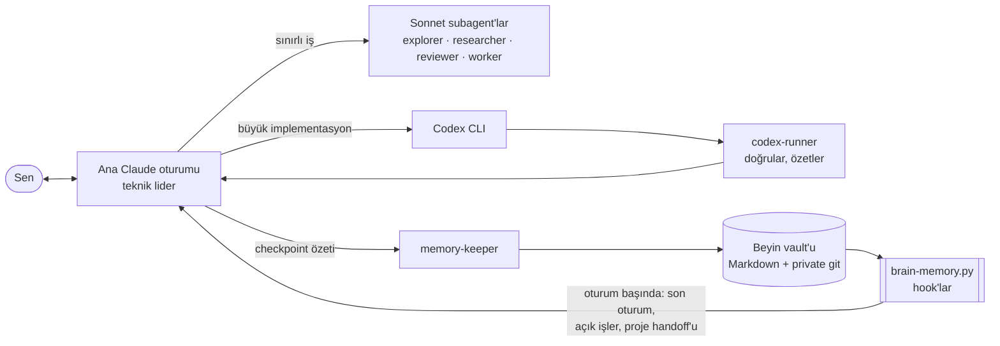
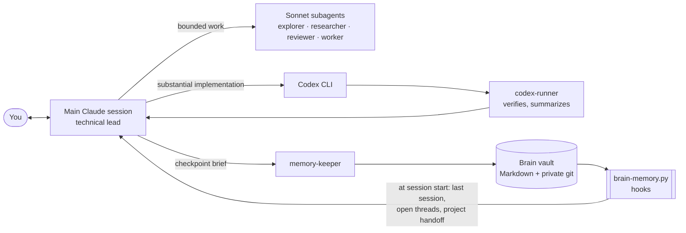

# My Agent System & Skills

🇹🇷 Türkçe · 🇬🇧 [English ↓](#english)

Claude Code ile her gün kullandığım çalışma düzeni: **kalıcı hafıza (beyin)**, **agent orkestrasyonu** ve **skill'ler**. Bu repoda yalnızca mekanizmanın kendisi var. Kurduğunda boş bir beyinle başlarsın ve onu sen doldurursun.

## Hızlı kurulum: agent'ına yaptır

Repo, bir agent'ın okuyup adım adım kurabileceği şekilde hazırlandı. Claude Code'u aç ve şunu yaz:

```text
https://github.com/bugrackm/My-Agent-System-and-Skills reposunu klonla, AGENTS.md dosyasını oku ve kurulumu benimle adım adım yap.
Hangi parçaları kurmak istediğimi önce bana sor.
```

Agent önce `~/.claude` klasörünü yedekler. Mevcut `settings.json` ve `CLAUDE.md` dosyalarının üzerine yazmaz, yeni ayarları mevcutlarla birleştirir. Bir dosyayı değiştirmeden önce sana sorar. Elle kurmak istersen her klasörün kendi `INSTALL.md` dosyası var.

Sadece `context-meter` plugin'ini istiyorsan:

```text
/plugin install context-meter --marketplace bugrackm/My-Agent-System-and-Skills
```

## İçindekiler

| Klasör | Ne işe yarar | Açıklama | Kurulum |
|---|---|---|---|
| [`brain/`](brain/) | Oturumlar arası kalıcı hafıza: Markdown vault, hook'lar, `memory-keeper` agent'ı (Linux/macOS) | [README](brain/README.md) | [INSTALL](brain/INSTALL.md) |
| [`brain-windows/`](brain-windows/) | Aynı beynin Windows'a özel, bağımsız sürümü | [README](brain-windows/README.md) | [INSTALL](brain-windows/INSTALL.md) |
| [`agents/`](agents/) | Orkestrasyon: ana model yönetir, Sonnet subagent'lar ve Codex CLI işi yapar | [README](agents/README.md) | [INSTALL](agents/INSTALL.md) |
| [`skills/`](skills/) | `game-dev-director`, `context-meter` | [README](skills/README.md) | [INSTALL](skills/INSTALL.md) |
| [`scripts/`](scripts/) | `check-public.sh`: yayınlamadan önce sızıntı taraması | — | — |

Parçalar birbirinden bağımsız. Sadece beyni, sadece agent'ları ya da sadece bir skill'i kurabilirsin.

**Windows'ta** `brain-windows/` kur. Aynı beyni Windows, Linux ve macOS'ta birlikte kullanmak istiyorsan Claude Code'u WSL içinde çalıştır ve `brain/` kur. Ayrıntılar: [brain-windows/README.md](brain-windows/README.md).

## Nasıl çalışır



- **Beyin:** her oturumun başında hook son oturumun özetini, açık işleri ve projenin `docs/ai/HANDOFF.md` dosyasını bağlama ekler. Önemli bir noktaya gelince ana oturum `memory-keeper` agent'ına kısa bir özet verir. Agent bunu vault'a yazar, commit'ler ve push'lar. Oturum hafıza yazılmadan kapanırsa bir sonraki oturum bunu fark eder ve kurtarma moduna geçer.
- **Orkestrasyon:** ana model planlar, karar verir ve sonucu kabul eder. Arama, araştırma, inceleme ve küçük işler ucuz Sonnet subagent'lara gider. Büyük kodlama işlerini Codex CLI yapar. Böylece ana bağlam terminal çıktısıyla dolmaz.

## Teşekkür: Avenox

Beyin sistemi, **Avenox**'un [**avenoxbeyin**](https://github.com/avenoxai/avenoxbeyin) projesinden ilham alınarak yapıldı. Fikir onların, teşekkürler. 🙏

avenoxbeyin çok daha kapsamlı bir sistem. Obsidian ve Claude Code ile çalışan bir ikinci beyin; Claude Code, Codex, Antigravity ve Kiro gibi birden fazla istemciyi, Windows, macOS ve Linux'u destekliyor. Link, sayfa ve YouTube yakalama, yerel arama ve tek komutla kurulum da sunuyor.

Bu repodaki beyin bilerek **daha küçük** tutuldu: tek bir Python hook dosyası, tek bir hafıza agent'ı ve düz Markdown klasörleri. Sadece Claude Code kullanıyorsan ve büyük bir sistemle uğraşmak istemiyorsan bunu kurmak daha kolay. Daha fazlasına ihtiyacın varsa doğrudan avenoxbeyin'e bak.

## Gereksinimler

- [Claude Code](https://code.claude.com/docs)
- Python 3.9+ ve git (beyin için; Windows'ta Python 3.10+ ve Git for Windows)
- *İsteğe bağlı:* [Codex CLI](https://github.com/openai/codex), büyük implementasyonları devretmek için. ChatGPT aboneliğinle giriş yapılır, API anahtarı gerekmez.

## Güvenlik

- **Beyin vault'unu private tut.** İçine zamanla kişisel bilgiler girecek. Bu public repo yalnızca boş şablonu içerir.
- Bu repoyu fork'layıp kendi değişikliklerini yayınlayacaksan önce `scripts/check-public.sh` çalıştır. Anahtar, token ve mutlak ev dizini yollarını arar. Kendi kişisel kelimelerini de gitignore'lu bir `.public-blocklist` dosyasına ekleyebilirsin.

## Lisans

[MIT](LICENSE)

---

<a id="english"></a>

## English

🇬🇧 English · 🇹🇷 [Türkçe ↑](#my-agent-system--skills)

The setup I use with Claude Code every day: **persistent memory (a "brain")**, **agent orchestration** and **skills**. This repo contains no personal data, only the mechanism itself. You start with an empty brain and fill it yourself.

### Quick install: let your agent do it

The repo is written so an agent can read it and install it step by step. Open Claude Code and say:

```text
Clone https://github.com/bugrackm/My-Agent-System-and-Skills, read AGENTS.md and walk me through the installation step by step.
Ask me first which parts I want to install.
```

The agent backs up `~/.claude` first. It never overwrites your existing `settings.json` or `CLAUDE.md`; it merges the new settings in. It asks you before changing any file. To install by hand, each folder has its own `INSTALL.md`.

If you only want the `context-meter` plugin:

```text
/plugin install context-meter --marketplace bugrackm/My-Agent-System-and-Skills
```

### Contents

| Folder | Purpose | Overview | Install |
|---|---|---|---|
| [`brain/`](brain/) | Persistent cross-session memory: Markdown vault, hooks, `memory-keeper` agent (Linux/macOS) | [README](brain/README.md) | [INSTALL](brain/INSTALL.md) |
| [`brain-windows/`](brain-windows/) | A standalone, Windows-only version of the same brain | [README](brain-windows/README.md#english) | [INSTALL](brain-windows/INSTALL.md#english) |
| [`agents/`](agents/) | Orchestration: the main model leads, Sonnet subagents and Codex CLI do the work | [README](agents/README.md) | [INSTALL](agents/INSTALL.md) |
| [`skills/`](skills/) | `game-dev-director`, `context-meter` | [README](skills/README.md) | [INSTALL](skills/INSTALL.md) |
| [`scripts/`](scripts/) | `check-public.sh`: leak scan before publishing | — | — |

The parts are independent. You can install only the brain, only the agents, or a single skill.

**On Windows**, install `brain-windows/`. To share one brain across Windows, Linux and macOS, run Claude Code inside WSL and install `brain/`. Details: [brain-windows/README.md](brain-windows/README.md#english).

### How it works



- **Brain:** at the start of every session, a hook adds the last session's summary, your open threads and the project's `docs/ai/HANDOFF.md` to the context. When you reach a meaningful checkpoint, the main session gives the `memory-keeper` agent a short brief. The agent writes it to the vault, commits and pushes. If a session closes without writing memory, the next session notices and switches to recovery mode.
- **Orchestration:** the main model plans, decides and accepts the result. Searching, research, review and small tasks go to cheap Sonnet subagents. Large coding work goes to Codex CLI. That keeps terminal output out of the main context.

### Credit: Avenox

The brain system was inspired by [**avenoxbeyin**](https://github.com/avenoxai/avenoxbeyin) by **Avenox**. The idea is theirs; thank you. 🙏

avenoxbeyin is a much larger system. It is a second brain built on Obsidian and Claude Code that supports several clients (Claude Code, Codex, Antigravity, Kiro) on Windows, macOS and Linux. It also offers link, page and YouTube capture, local search and one-command installation.

The brain in this repo is **deliberately smaller**: a single Python hook file, one memory agent and plain Markdown folders. If you only use Claude Code and don't want to deal with a large system, this one is easier to set up. If you need more, go straight to avenoxbeyin.

### Requirements

- [Claude Code](https://code.claude.com/docs)
- Python 3.9+ and git (for the brain; on Windows, Python 3.10+ and Git for Windows)
- *Optional:* [Codex CLI](https://github.com/openai/codex), for delegating substantial implementation. You sign in with your ChatGPT subscription; no API key is needed.

### Security

- **Keep your brain vault private.** Over time it will hold personal information. This public repo only contains the empty template.
- If you fork this repo and publish your own changes, run `scripts/check-public.sh` first. It looks for keys, tokens and absolute home-directory paths. You can add your own personal words to a gitignored `.public-blocklist` file.

### License

[MIT](LICENSE)
